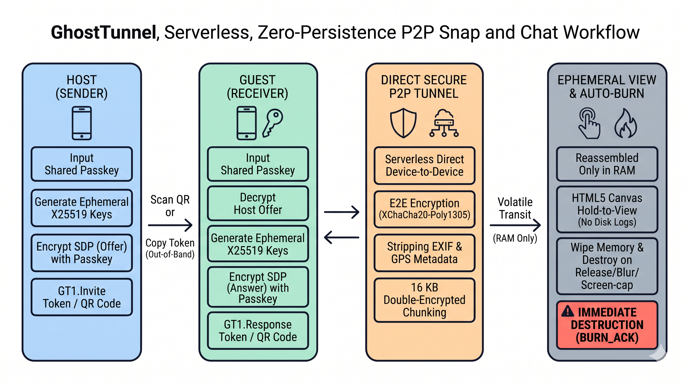

# GhostTunnel

A serverless, browser-based app for sharing ephemeral photos and short messages directly between two devices. No accounts, no backend database, no signaling server, and nothing saved to disk.



## Why I Built This

Most private messaging apps still rely on a central server in the middle. Even when messages are end-to-end encrypted, a server usually handles the handshake, logs metadata (who connected and when), or temporarily stores encrypted media until the other person comes online. On the client side, normal web apps also leave traces behind in browser cache, cookies, or local storage.

I wanted a lightweight personal tool, similar in spirit to Snapchat, for sharing quick photos and short chats with a few trusted people where:

- No third-party server ever touches the messages, photos, or connection tokens.
- Nobody can open a session unless both people have the agreed passkey and manually approve the pairing.
- Nothing is cached or written to disk on either device.
- Photos can only be viewed while holding down on the screen, and get wiped from memory the moment you let go.

## How It Works

Instead of running a backend server to introduce two users, GhostTunnel runs completely as a static webpage and connects both browsers directly over WebRTC.

```text
Host (Passkey + Invite Token) ---> Out-of-band (WhatsApp / QR) ---> Guest (Passkey + Response Token)
Host <--- Out-of-band (Response Token / QR) <--- Guest
Host <======== Direct Encrypted Peer-to-Peer Tunnel (RAM Only) ========> Guest
```

1. **Agree on a Shared Passkey:** Both people decide on a short secret passkey beforehand.
2. **Mutual Key Handshake:** The Host generates an encrypted Invite Token (GT1...) or QR code and sends it to the Guest. The Guest decrypts it using the passkey, approves it, and sends back an encrypted Response Token. Because the tokens are encrypted with the passkey, whatever chat app you use to copy-paste them cannot read what is inside.
3. **Verify and Connect:** Once the Host accepts the Response Token, both browsers open a direct peer-to-peer connection and show the same 6-digit Safety Number so both sides know nobody tampered with the exchange.
4. **View and Burn:** Text messages disappear automatically after a short timer. Photos require pressing and holding on the screen to view. Lifting your finger, running out of time, switching tabs, or closing the browser immediately wipes the image from RAM and sends a burn confirmation back to the sender.

## Key Engineering Decisions

I kept the system small and strict so it is easy to audit:

- **Zero Disk Persistence:** The app never uses localStorage, sessionStorage, IndexedDB, cookies, or Service Workers. Every message, photo buffer, and encryption key lives only in JavaScript memory (RAM) and disappears when the tab closes.
- **Double-Layer Encryption:** WebRTC encrypts traffic natively with DTLS. On top of that, GhostTunnel derives fresh per-session X25519 keys and encrypts every chat message and photo chunk with XChaCha20-Poly1305 (via libsodium) before it hits the network. Each packet also checks a strict sequence number to stop replay or reordering attacks.
- **EXIF and GPS Stripping:** Before a photo leaves the sender's device, it is redrawn onto an offscreen canvas and re-encoded. This strips out hidden camera details and GPS coordinates automatically.
- **Canvas-Only Photo Viewing:** Incoming photos are never turned into `` tags or downloadable `blob:` URLs. They are decoded into a temporary bitmap, painted onto an HTML5 `<canvas>` only while pressed, and zeroed out in memory (`sodium.memzero`) the instant viewing stops.
- **Strict Anti-Cache Headers:** Deployed with `Cache-Control: no-store`, `Clear-Site-Data`, and a strict Content Security Policy (`public/_headers`) so browsers do not cache responses or leak requests to external domains.

## Honest Limitations

No web app is magic, and it helps to be clear about what this design cannot solve:

- **Both people must be online together:** Because there is no server holding an inbox, both devices need the page open at the same time to pair and talk.
- **The physical camera problem:** Browser guardrails stop casual saving, caching, and tab-switching, but no website can physically stop someone from pointing a second phone camera at their screen or using an OS-level screen recorder. GhostTunnel is built to stop third-party leaks and accidental device history, not an untrusted recipient.
- **Strict 4G/5G mobile networks:** Direct peer-to-peer connections work smoothly on Wi-Fi and most mixed networks. However, if both phones are on strict symmetric mobile carrier NATs at the exact same time, direct hole-punching can get blocked. For that case, the Network menu lets you plug in your own self-hosted Coturn relay server (and because payloads are already encrypted inside the browser, the relay still only sees unreadable ciphertext).

## Tech Stack

- **Frontend:** React 19, TypeScript (strict mode), Vite, Tailwind CSS v4
- **Cryptography:** libsodium-wrappers-sumo (Argon2id, X25519, XChaCha20-Poly1305, memzero)
- **Transport:** Native WebRTC RTCDataChannel
- **QR Pairing:** Offline qrcode canvas rendering and browser BarcodeDetector (with manual paste fallback)
- **Testing & Hosting:** Vitest, automated dual-tab browser E2E check, Cloudflare Pages

## Running Locally

Requires Node.js 20+.

```bash
# Install dependencies
npm install

# Start the local dev server
npm run dev

# Run unit tests (cryptography and photo chunking)
npx vitest run

# Build static production bundle (outputs to dist/ with zero source maps)
npm run build
```

To test it by yourself, open `http://localhost:5173` in two separate browser tabs (one as Host, one as Guest) and pair them with the same passkey.

## Deploying on Cloudflare Pages

Because there is no backend, you can host your own private copy for free:

1. Connect this repository in Cloudflare Dashboard -> Workers & Pages -> Pages -> Connect to Git.
2. Set build command to `npm run build` and output directory to `dist`.
3. Add an environment variable `NODE_VERSION` set to `22` (or `20`).
4. Deploy. Cloudflare automatically enforces `public/_headers` on every request.

**Optional Invite-Only Lock:** If you do not want strangers to even load the webpage, put your Pages URL behind Cloudflare Zero Trust -> Access with an Email One-Time PIN policy listing only your own email and your friends' emails.

## Deep-Dive Documentation

If you want the exact binary packet layouts, threat model, and architecture notes, they are kept separately under `docs/`:

- [Product Requirements (PRD)](docs/PRD.md)
- [Technical R&D & Protocol Spec](docs/TECHNICAL_RD.md)
- [Architecture Decision Records](docs/DECISIONS.md)
- [Security & Zero-Persistence Policies](docs/POLICIES.md)
